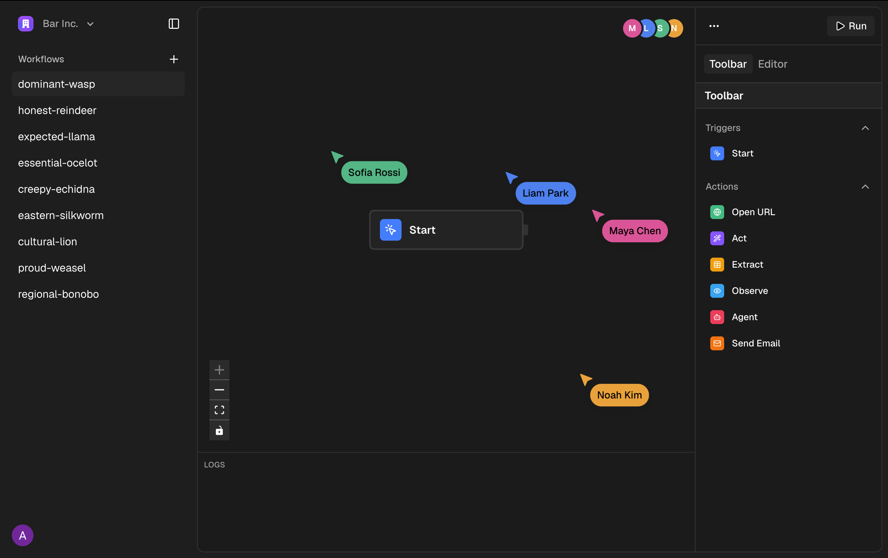
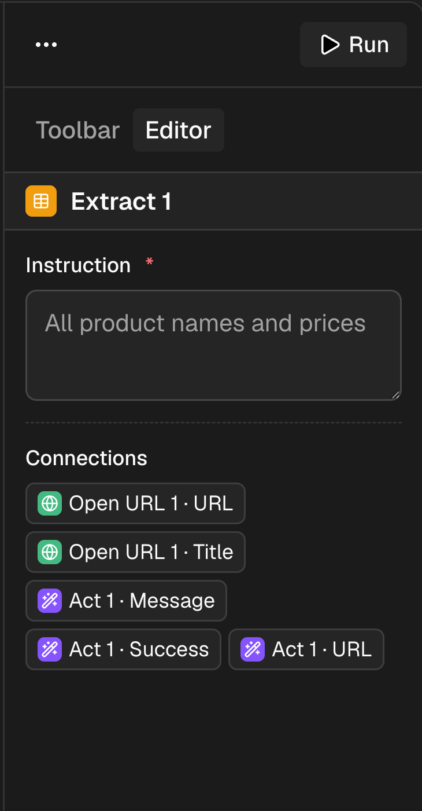
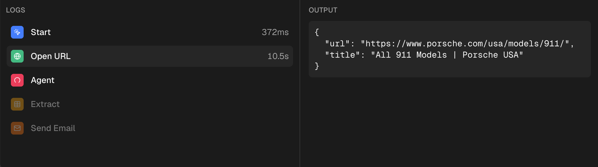
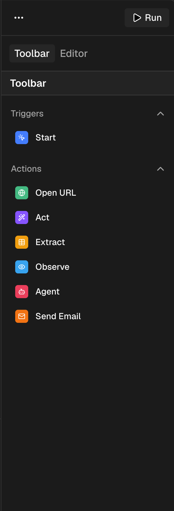
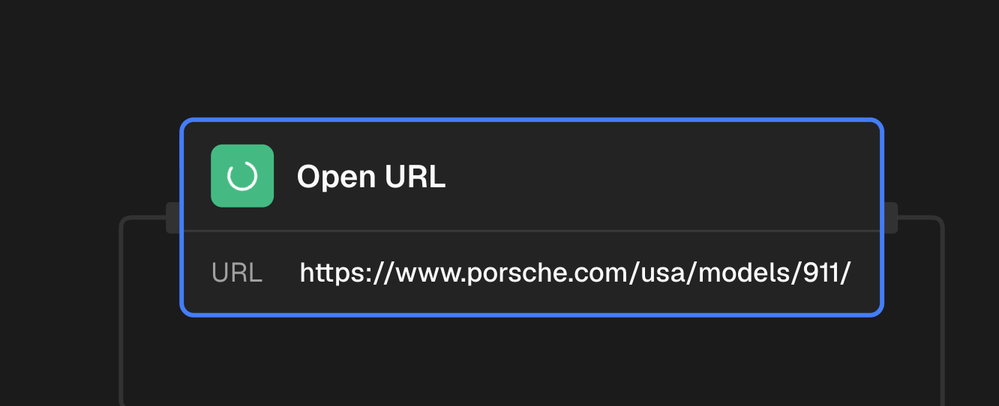

# Browser Automation

Build browser automation workflows visually, run them in managed browser sessions, and inspect each run from the canvas.



## Features

- Build workflows on a drag-and-drop React Flow canvas.
- Collaborate with organization members in real time through Liveblocks.
- Validate, save, and execute workflow graphs with Trigger.dev.
- Follow run status and node outputs in the run console.
- Automate browser sessions with Browserbase and Stagehand, then open session replays.
- Store organization-owned workflows in Neon Postgres using Drizzle ORM.
- Sign in and manage organizations with Clerk.
- Send workflow email through Resend.
- Use Sentry for application and background-task error reporting.

## Screenshots

### Workflow canvas and node editor



### Run history and step outputs



### Workflow node palette



### Live workflow progress



## How a workflow runs

1. Sign in and select an active Clerk organization.
2. Create or open a workflow. Its graph is edited on a shared canvas.
3. Add a **Start** trigger and connect action nodes. Configure each selected node in the Editor tab. Later nodes can use upstream values with `{{ node-id.field }}` placeholders.
4. Select **Run**. The app validates and saves the graph, then triggers the `run-workflow` Trigger.dev task with the workflow and organization IDs.
5. The task orders connected nodes by their graph edges, runs them in dependency order, and publishes node status and output to Trigger.dev metadata.
6. The run console subscribes to runs tagged `workflow:<workflow-id>`. Browser actions share one lazily opened Browserbase session; after completion, the console can open its replay.

Each workflow needs exactly one Start node, connected steps, and no cycles. Disconnected nodes are not executed.

## Workflow nodes

| Node | What it does |
| --- | --- |
| **Start** | Marks the workflow entry point. |
| **Open URL** | Opens a URL in the shared browser session. |
| **Act** | Performs a natural-language browser action. |
| **Extract** | Extracts requested information from the current page. |
| **Observe** | Finds elements matching a natural-language description. |
| **Agent** | Uses Stagehand to complete a natural-language browser goal. Requires the configured Clerk organization plan. |
| **Send Email** | Sends an HTML email through Resend. |

Browser nodes can produce outputs for downstream nodes. The run console shows each node's status, duration, output, and errors.

## Architecture

```text
Clerk authentication and organization
              |
       Next.js application
        /      |       \
 React Flow  Liveblocks  Drizzle ORM -> Neon Postgres
        |
  Trigger.dev task
        |
 Browserbase + Stagehand -> browser session and replay
        |
      Resend -> email
```

The workflow page mints a short-lived Trigger.dev public token scoped to that workflow's run tag. The browser uses that token for the read-only realtime run subscription; the Trigger.dev secret key stays on the server.

## Local development

### Requirements

- Node.js compatible with Next.js 16
- A Clerk application with organizations enabled
- A Neon Postgres database
- A Trigger.dev project
- Browserbase credentials for browser automation
- Resend credentials if using Send Email
- Sentry credentials are optional for local error reporting

### Setup

1. Install dependencies:

   ```bash
   npm install
   ```

2. Create `.env.local` in the project root. Use values from your own service accounts; do not commit secrets.

   ```dotenv
   NEXT_PUBLIC_CLERK_PUBLISHABLE_KEY=
   CLERK_SECRET_KEY=
   NEXT_PUBLIC_CLERK_SIGN_IN_URL=/sign-in
   NEXT_PUBLIC_CLERK_SIGN_UP_URL=/sign-up
   NEXT_PUBLIC_CLERK_SIGN_IN_FALLBACK_REDIRECT_URL=/
   NEXT_PUBLIC_CLERK_SIGN_UP_FALLBACK_REDIRECT_URL=/

   DATABASE_URL=
   DATABASE_URL_UNPOOLED=

   TRIGGER_SECRET_KEY=
   BROWSERBASE_API_KEY=
   RESEND_API_KEY=

   NEXT_PUBLIC_LIVEBLOCKS_PUBLIC_KEY=
   LIVEBLOCKS_SECRET_KEY=

   NEXT_PUBLIC_SENTRY_DSN=
   SENTRY_DSN=
   SENTRY_AUTH_TOKEN=
   ```

   `BROWSERBASE_API_KEY` is also used by Stagehand's configured Gemini model through Browserbase's Model Gateway; this app does not read a separate Gemini key. Sentry variables can be omitted if Sentry is not being configured.

3. Apply the database schema to the configured Neon database:

   ```bash
   npm run db:push
   ```

4. Start the Next.js app:

   ```bash
   npm run dev
   ```

5. In a second terminal, start the Trigger.dev development worker:

   ```bash
   npx trigger.dev@latest dev
   ```

Open the local URL printed by Next.js. For deployed use, configure the same integrations in Vercel and deploy the Trigger.dev task to the corresponding Trigger.dev environment.

## Configuration notes

- Clerk billing plans are checked by **plan slug**, not display name. Keep the organization plan slug used in the feature gates consistent with the plan configured in the active Clerk instance. Development and production Clerk instances have separate users, plans, and subscriptions.
- The Agent node and replay access are plan-gated. Update the plan check consistently in the client hook and server routes/actions when changing the configured slug.
- Realtime run history is filtered by the `workflow:<id>` Trigger.dev tag. The server mints a tag-scoped public token for the active workflow.
- Stagehand is configured in `features/workflows/tasks/run-workflow.ts` to use `google/gemini-3.8-flash` through Browserbase Model Gateway.

## Useful commands

| Command | Purpose |
| --- | --- |
| `npm run dev` | Start the Next.js development server. |
| `npx trigger.dev@latest dev` | Start the Trigger.dev development worker. |
| `npm run build` | Build the Next.js app. |
| `npm run start` | Serve the production build locally. |
| `npm run lint` | Run ESLint. |
| `npm run typecheck` | Run TypeScript checks. |
| `npm run db:push` | Push the Drizzle schema to the configured database. |
| `npm run db:generate` | Generate a database migration. |
| `npm run db:migrate` | Apply generated migrations. |

